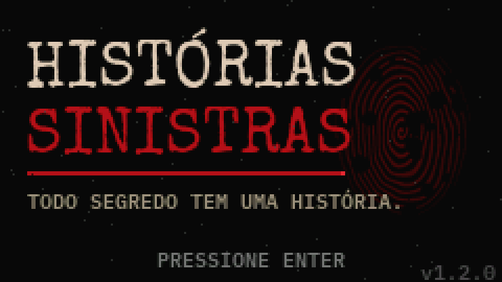
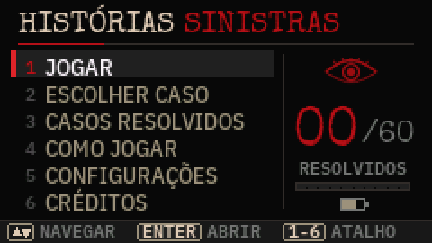
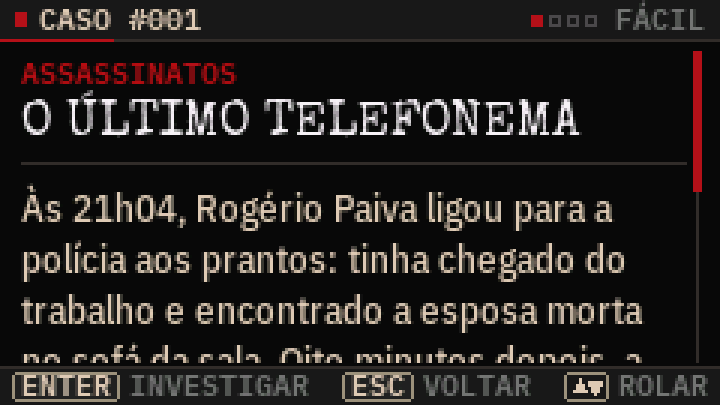
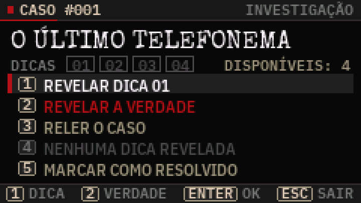
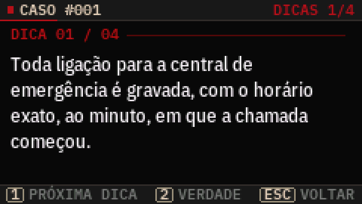
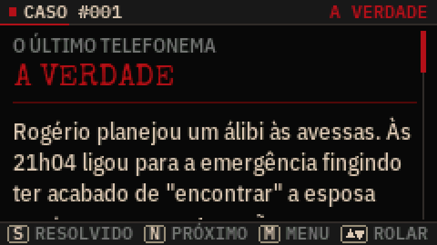
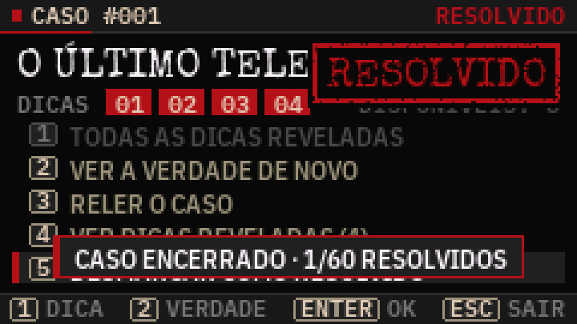
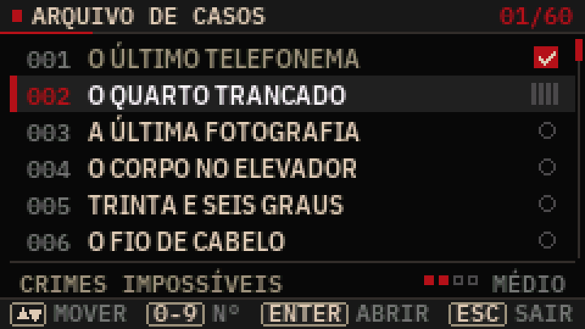
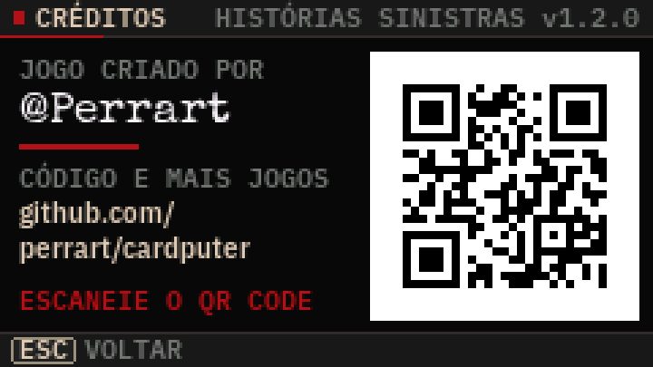

# HISTÓRIAS SINISTRAS

**Todo segredo tem uma história.**

Jogo de mistério e investigação para o **M5Stack Cardputer ADV**, criado por **[@Perrart](https://github.com/perrart/cardputer)**.

São 60 casos originais em português do Brasil: mortes estranhas, crimes impossíveis, desaparecimentos e segredos macabros. Leia o cenário, revele até quatro dicas e descubra o que realmente aconteceu. Dá para jogar sozinho ou em grupo, 100% offline.

  



| | |
|---|---|
|  |  |
|  |  |
|  |  |
|  |  |

*Capturas do simulador de PC, que roda o mesmo código do firmware (240×135 ampliado 3×).*

> **Quick start (English):** download `historias_sinistras.bin` from the Releases page and flash it at address **0x0** on the Cardputer ADV (ESP32‑S3, 8 MB), e.g. with <https://espressif.github.io/esptool-js/> or `esptool --chip esp32s3 write-flash 0x0 historias_sinistras.bin`. To enter download mode: power switch OFF, hold **G0**, switch ON (or plug USB), release G0. All in‑game text is Brazilian Portuguese. Free for any noncommercial use, see [License](#licença).

---

## Download

Os arquivos prontos para gravar ficam na aba **Releases** deste repositório.

| Arquivo | Para que serve | Endereço de gravação |
|---|---|---|
| `historias_sinistras.bin` | **Imagem completa** (bootloader + tabela de partições + boot_app0 + jogo). Use na primeira instalação. | **0x0** |
| `historias_sinistras_app.bin` | Só o aplicativo. Serve para atualizar sem perder o progresso e para launchers via cartão SD. | **0x10000** |
| `historias_sinistras_flash_parts.zip` | Bootloader, partições, boot_app0 e app separados, para gravação manual | ver abaixo |
| `SHA256SUMS.txt` | Somas de verificação | — |

Não é preciso cartão SD nem imagem de sistema de arquivos: os casos e as fontes ficam embutidos no firmware.

Mapa da flash (8 MB, esquema `default_8MB`):

| Partição | Tipo | Início | Tamanho |
|---|---|---|---|
| nvs (progresso e configurações) | data/nvs | 0x9000 | 20 KB |
| otadata | data/ota | 0xE000 | 8 KB |
| app0 (o jogo) | app/ota_0 | 0x10000 | 3264 KB |
| app1 | app/ota_1 | 0x340000 | 3264 KB |
| spiffs (não usada) | data/spiffs | 0x670000 | 1536 KB |
| coredump | data/coredump | 0x7F0000 | 64 KB |

O jogo ocupa cerca de 800 KB (24% da partição de aplicativo).

---

## Instalação

### Modo de gravação (download) do Cardputer ADV
1. Deslize a chave lateral de energia para **OFF**.
2. Segure o botão **G0**.
3. Ligue a chave (ou conecte o cabo USB‑C ao computador) e solte o **G0**.

A tela fica apagada nesse modo. É normal.

### Opção A: pelo navegador, sem instalar nada
1. Abra <https://espressif.github.io/esptool-js/> no Chrome ou no Edge.
2. Coloque o Cardputer em modo de gravação e clique em **Connect**. Escolha a porta USB que aparecer.
3. Em *Flash Address* use **0x0** e selecione `historias_sinistras.bin`.
4. Clique em **Program** e espere terminar.
5. Desligue e ligue o Cardputer pela chave lateral. A abertura do jogo aparece.

### Opção B: esptool (linha de comando)
```bash
pip install esptool
esptool --chip esp32s3 --baud 921600 write-flash 0x0 historias_sinistras.bin
```
No esptool 4.x o comando é `esptool.py --chip esp32s3 --baud 921600 write_flash 0x0 historias_sinistras.bin`. Se a porta não for detectada, acrescente `--port COM5` (Windows) ou `--port /dev/ttyACM0` (Linux/macOS).

Gravação manual por partes (equivale à imagem completa):
```bash
esptool --chip esp32s3 write-flash --flash-mode dio --flash-freq 80m --flash-size 8MB \
  0x0 bootloader.bin 0x8000 partitions.bin 0xe000 boot_app0.bin 0x10000 firmware_app.bin
```

### Opção C: launcher no cartão SD (M5Launcher, Bruce etc.)
Copie `historias_sinistras_app.bin` para o cartão e instale pelo menu do launcher. Use o arquivo **_app**: a imagem completa não serve para launchers.

### Atualizar sem perder o progresso
A imagem completa (`historias_sinistras.bin` em 0x0) também regrava a área onde o progresso fica salvo, então **apaga os casos resolvidos**. Para atualizar mantendo o progresso, grave só o aplicativo:

- No navegador (esptool-js): *Flash Address* **0x10000** e o arquivo `historias_sinistras_app.bin`.
- Na linha de comando: `esptool --chip esp32s3 --baud 921600 write-flash 0x10000 historias_sinistras_app.bin`

O progresso é guardado pelo número do caso, então casos novos aparecem como não jogados e os antigos continuam resolvidos.

### Apagar o progresso
No próprio jogo: **Configurações → Zerar progresso**. Para apagar a flash inteira: `esptool --chip esp32s3 erase-flash` e grave de novo.

---

## Controles

O teclado do Cardputer tem as setas impressas nas teclas `;` `,` `.` `/`. **Não é preciso segurar Fn.**

| Tecla | Ação |
|---|---|
| `;` (↑) e `.` (↓) | Navegar nos menus e rolar o texto |
| `,` (←) e `/` (→) | Página anterior / próxima (textos e listas) |
| `ENTER` ou botão `G0` | Confirmar / continuar |
| `` ` `` (ESC) ou `DEL` | Voltar / cancelar |
| `1` | Revelar a próxima dica |
| `2` | Revelar a verdade |
| `3` / `R` | Reler o caso (na investigação) · `R` recomeça o caso na tela da verdade |
| `4` / `D` | Ver as dicas já reveladas |
| `5` / `S` | Marcar ou desmarcar o caso como resolvido (`S` também funciona na tela da verdade) |
| `N` | Próximo caso |
| `M` | Menu principal |
| `0`–`9` | No arquivo de casos, digite o número para pular direto ao caso |
| `ESPAÇO` | Avança uma página no texto |

Durante o efeito de máquina de escrever, qualquer tecla mostra o texto inteiro. Cada tecla dispara uma ação por toque (sem repetição ao segurar), exceto as setas, que repetem para rolar mais rápido.

---

## Como jogar

**Sozinho:** abra um caso, leia o cenário e monte uma teoria. Se travar, revele as dicas uma a uma: elas ficam cada vez mais reveladoras. Quando tiver certeza, revele a verdade. Se acertou, marque o caso como resolvido. O desafio é acertar com o menor número de dicas.

**Em grupo:** um jogador é o *Guardião do Segredo*. Ele lê a verdade escondido, e os outros fazem perguntas que só podem ser respondidas com **sim**, **não** ou **irrelevante**. Quando o grupo empaca, o Guardião revela uma dica em voz alta. Vence quem explicar a história inteira.

Fluxo de cada caso:

1. **Apresentação:** número, categoria, dificuldade, título e cenário.
2. **Investigação:** as dicas reveladas (01–04) e o menu do caso: revelar dica, revelar a verdade, reler o caso, ver dicas e marcar como resolvido.
3. **Dicas:** cada uma exige um toque deliberado, e as anteriores continuam visíveis.
4. **A verdade:** abre direto, com a explicação completa e rolagem. O caso **não** é marcado sozinho. Dali: `S` marca como resolvido, `N` abre o próximo caso, `M` volta ao menu e `ESC` volta ao menu do caso.
5. **Marcar como resolvido:** carimba o caso, salva o progresso e mostra o placar. Escolher de novo desmarca.

**JOGAR**, no menu principal, continua o caso em andamento (inclusive um caso cuja verdade já foi lida mas não foi marcado) ou abre o próximo ainda não resolvido. O **Arquivo de casos** mostra o status de cada um: ○ novo · barras = em andamento (dicas reveladas) · ✓ vermelho = resolvido.

O menu principal também tem **Como jogar**, **Configurações** e **Créditos**.

---

## Configurações (salvas automaticamente)

- **Som:** ligado / desligado
- **Volume:** baixo / médio / alto
- **Velocidade do texto:** normal / rápida / instantânea
- **Tamanho do texto:** normal / grande
- **Brilho:** 4 níveis
- **Zerar progresso:** pede confirmação, e o ENTER só é aceito depois de um instante para evitar toques acidentais

A tela escurece após 90 s sem uso. A primeira tecla só a acende de novo.

---

## Os casos

60 casos originais, 7 categorias e 4 níveis de dificuldade:

| Dificuldade | Casos |
|---|---|
| FÁCIL | 11 |
| MÉDIO | 26 |
| DIFÍCIL | 16 |
| INSANO | 7 |

Categorias: Assassinatos (11), Crimes Impossíveis (10), Mortes Misteriosas (8), Desaparecimentos (8), Segredos Macabros (8), Mistérios Psicológicos (8), Acidentes Fatais (7).

Cada caso tem título, um cenário curto que termina numa pergunta, quatro dicas progressivas e uma verdade que amarra todas as dicas. Os títulos foram escolhidos para não entregar a resposta, e os nomes de personagens não se repetem entre casos.

### Criando novos casos
Os casos vivem em `content/casos.txt`, em texto simples:

```
=== CASO 061
TITULO: O NOVO MISTÉRIO
CATEGORIA: ASSASSINATOS
DIFICULDADE: MÉDIO
CENARIO:
Texto do cenário, terminando com uma pergunta?
DICA 1:
...
DICA 2:
...
DICA 3:
...
DICA 4:
...
VERDADE:
Primeiro parágrafo.

Segundo parágrafo.
```

Depois rode `python3 tools/gen_mysteries.py` e recompile. O script confere os campos, exige exatamente 4 dicas, IDs únicos de 1 a 255, categorias e dificuldades válidas e se todos os caracteres existem nas fontes. Como o progresso é guardado por ID, adicionar casos não apaga o que já foi resolvido.

Dicas de escrita: cenário de 180 a 380 caracteres, dicas de 70 a 200 e verdade de 450 a 900. Use acentos normalmente. Símbolos fora do português (setas, emojis) são recusados pelo validador.

---

## Compilando a partir do código‑fonte

### PlatformIO (recomendado)
```bash
pip install platformio
pio run                 # gera release/historias_sinistras.bin e release/historias_sinistras_app.bin
pio run -t upload       # grava pela USB (o app; para a imagem completa use o esptool)
```
O `platformio.ini` usa a plataforma **pioarduino 55.03.312** (Arduino‑ESP32 3.3.12 / ESP‑IDF 5.5) e as bibliotecas fixadas nas versões testadas: M5GFX 0.2.34, M5Unified 0.2.27 e M5Cardputer (commit `f139285`, com suporte ao teclado TCA8418 do ADV).

### Arduino CLI
```bash
./build.sh
```
Instala o núcleo ESP32 3.3.12, baixa as bibliotecas nas mesmas versões, compila com a placa *M5Cardputer* (8 MB, partição `default_8MB`) e monta os binários em `release/`.

### GitHub Actions
O workflow `.github/workflows/build.yml` compila a cada push. Em um fork: aba **Actions → Build firmware → Run workflow**, depois baixe o artefato `historias_sinistras-firmware`.

### Regenerar fontes e arte
`python3 tools/gen_assets.py` (requer `pip install freetype-py pillow`) recria `src/AssetFonts.h` e `src/AssetArt.h` a partir de `assets/fonts/`.

---

## Arquitetura

Código C++ modular, sem `String` nem alocação dinâmica no laço do jogo, organizado como máquina de estados não bloqueante:

| Módulo | Função |
|---|---|
| `main.cpp` | `setup()`/`loop()` do Arduino |
| `GameEngine` | Máquina de estados, transições (glitch, varredura, clarão), redesenho sob demanda, economia de tela |
| `Screens*.cpp` | As 12 telas (abertura, menu, apresentação, investigação, dicas, verdade, arquivo, resolvidos, como jogar, configurações, zerar, créditos) |
| `ScreenManager` | Cabeçalho, rodapé com teclas, carimbos, ícones, máscaras de pixel‑art, efeitos |
| `StoryRenderer` | Quebra de linha por palavra em UTF‑8, blocos com estilos, rolagem suave, máquina de escrever |
| `InputManager` | Detecção de borda, debounce, auto‑repetição só nas setas |
| `MysteryDatabase` | Acesso aos casos embutidos (`MysteryData.h`, gerado) |
| `ProgressManager` | Progresso por ID de caso na NVS (grava só quando algo muda) |
| `SettingsManager` | Configurações na NVS (grava só ao sair da tela, se mudou) |
| `AudioManager` | Sequências de efeitos agendadas, não bloqueantes |
| `Fonts` | Fontes suaves VLW embutidas com acentuação completa |
| `Platform*.cpp` | Camada de hardware: Cardputer ADV ou simulador de PC |

**Vídeo:** framebuffer de 240×135 em RAM enviado inteiro ao ST7789V2, sem cintilação. Só redesenha quando algo muda ou há animação.
**Teclado:** a biblioteca M5Cardputer detecta a placa e usa o controlador **TCA8418** no ADV (I2C, interrupção no GPIO11). O jogo lê a lista de teclas sem as alocações de `updateKeysState()`.
**Áudio:** a M5Unified inicializa o codec **ES8311** e o amplificador **NS4150B** do ADV (I2S1). Os sons são tons senoidais e amostras curtas geradas na inicialização, disparadas sem bloquear. Se o alto‑falante não iniciar, o jogo segue em silêncio.
**Texto:** fontes Special Elite (títulos, estilo máquina de escrever) e IBM Plex Sans Condensed / Plex Mono (texto e rótulos), convertidas para VLW anti‑aliased com todos os acentos do português.

### Simulador de PC
`sim/` compila o **mesmo código do jogo** para Linux com a M5GFX, roda um roteiro de teclas, salva capturas de tela e verifica regras automaticamente: cobertura de glifos e largura de linhas nos 60 casos, nas duas fontes; navegação; limite de 4 dicas; verdade sem resolver o caso sozinha e marcação manual de resolvido; persistência após reinício; ausência de gravações desnecessárias na flash; confirmação de zerar progresso.
```bash
sudo apt install libsdl2-dev
make -C sim M5GFX=/caminho/para/M5GFX
./sim/build/hs_sim sim/out && python3 tools/ppm2png.py sim/out
```

---

## Status de validação

| Verificação | Resultado |
|---|---|
| Compilação para ESP32‑S3 (arduino‑cli, núcleo 3.3.12), que gera os binários distribuídos | ✅ sem erros e sem avisos |
| Imagem identificada como ESP32‑S3 (chip ID 9), flash 8 MB DIO 80 MHz | ✅ `esptool image-info` |
| 60 casos, 4 dicas cada, IDs únicos, glifos presentes, sem estouro de linha | ✅ validador + simulador |
| Navegação, dicas, verdade, marcação de resolvido, créditos, persistência e configurações | ✅ roteiro automático no simulador |
| QR code dos créditos | ✅ decodificado e testado: abre github.com/perrart/cardputer |
| Cardputer ADV físico | ✅ versão 1.1.0 rodando no aparelho do autor · ⚠️ 1.2.0 compilada e simulada, ainda sem teste no aparelho |

Se algo se comportar de forma inesperada, o monitor serial (115200 baud) mostra na inicialização a placa detectada, o estado do áudio e da NVS. Problemas e sugestões são bem-vindos na aba **Issues**.

---

## Licença

**Uso livre para diversão, proibido vender.** O código e os casos do HISTÓRIAS SINISTRAS estão sob a **[PolyForm Noncommercial License 1.0.0](LICENSE.md)**.

Você **pode**, sem pedir permissão:
- jogar, copiar e compartilhar o jogo;
- modificar o código, criar casos novos e fazer versões suas;
- publicar essas versões, desde que também sem fins comerciais;
- usar em escolas, ONGs, clubes, eventos gratuitos e projetos pessoais.

Você **não pode**:
- vender o jogo, os casos ou versões modificadas;
- usá-lo em produto, serviço ou evento com fins lucrativos.

Ao compartilhar o jogo, original ou modificado, mantenha o arquivo [`LICENSE.md`](LICENSE.md) (ou o link <https://polyformproject.org/licenses/noncommercial/1.0.0>) e a linha de aviso de autoria:

```
Required Notice: Copyright (c) 2026 Perrart (https://github.com/perrart/cardputer)
```

Este resumo é só um guia. O que vale é o texto da licença. Para uso comercial, fale com o autor.

Fontes e bibliotecas de terceiros mantêm suas próprias licenças (Apache 2.0, SIL OFL 1.1, MIT, LGPL 2.1). Veja [`THIRD_PARTY_NOTICES.md`](THIRD_PARTY_NOTICES.md).

---

## Créditos

- Jogo criado por **[@Perrart](https://github.com/perrart/cardputer)**: <https://github.com/perrart/cardputer>. Os créditos também aparecem no menu **Créditos** do jogo.
- Bibliotecas: [M5Unified](https://github.com/m5stack/M5Unified), [M5GFX](https://github.com/m5stack/M5GFX) e [M5Cardputer](https://github.com/m5stack/M5Cardputer), da M5Stack.
- Fontes: *Special Elite* (Astigmatic) e *IBM Plex* (IBM).
- Inspirado na mecânica de jogos de "histórias sinistras". Todos os casos, personagens e soluções são originais.

Histórico de versões: [`CHANGELOG.md`](CHANGELOG.md).
